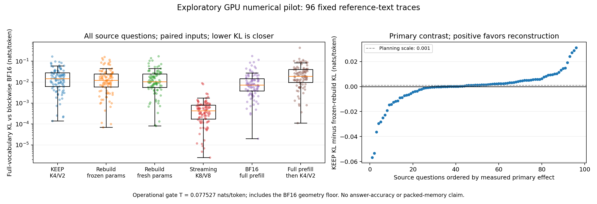
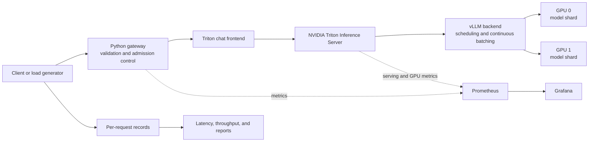
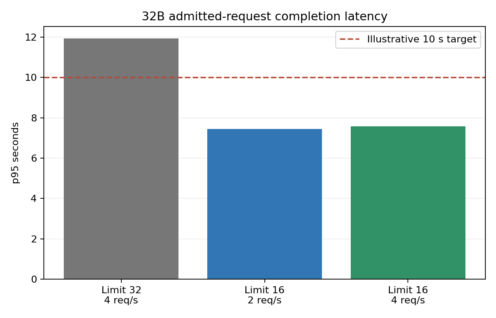
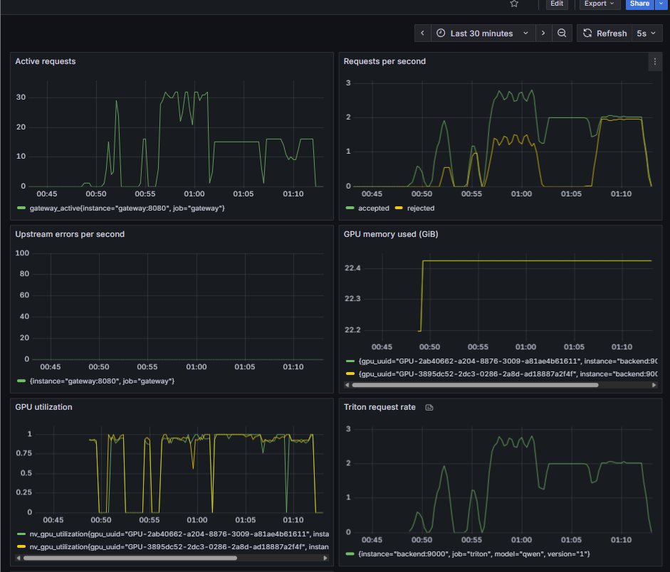
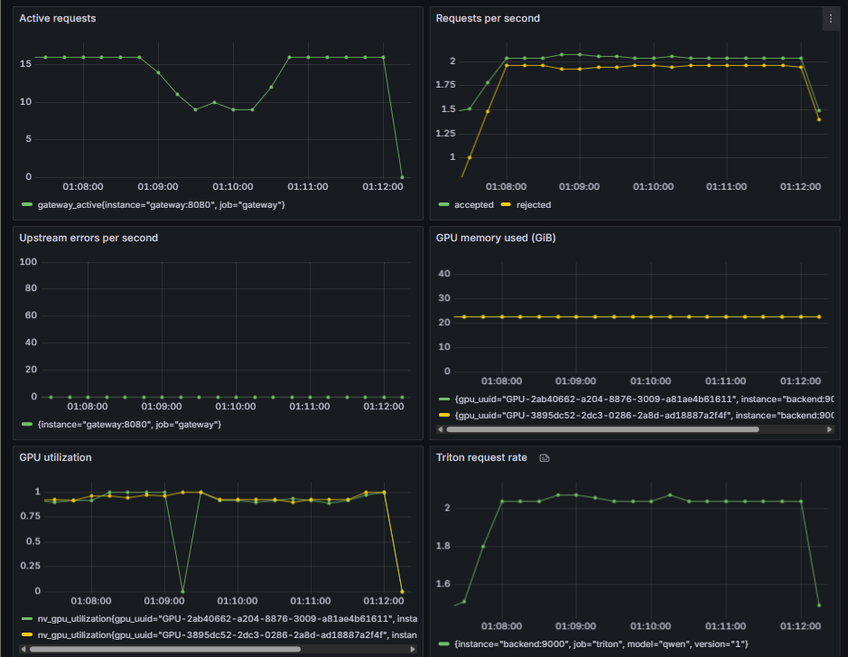
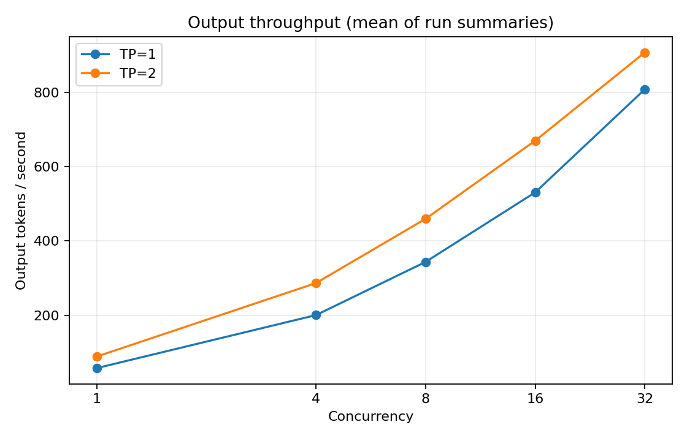

# Inference Lab: NVIDIA Triton, vLLM, and GPU Experiments

A hands-on repository for **serving LLM inference with NVIDIA Triton Inference Server and vLLM, then using rented GPUs to test ideas about inference**. It includes a streaming gateway, multi-GPU deployments, load generators, monitoring dashboards, and experiments with published measurements and reproducible evidence.

The project started by testing how model placement, concurrency, and admission control affect throughput and latency. It now also includes model-level experiments that test numerical ideas directly against a model, alongside the serving stack.


[Serving guide](docs/serving.md) · [Published serving results](results/README.md) · [Cache-reconstruction report](reports/cache-repair/report.md) · [Experiment workflow](docs/research-workflow.md)

## Questions explored

| Question | What the experiment found |
|---|---|
| **Rebuilding compressed KV:** can replaying the same tokens repair numerical distortion in a compressed attention cache? | Four initial smoke experiments looked promising before the full GPU run, but the 96 new GPU questions did not demonstrate a mean benefit. Larger regressions offset more frequent gains. [Cache-reconstruction pilot](reports/cache-repair/report.md) |
| **Batch instability:** can changes across batch conditions reveal errors or useful alternatives beyond ordinary token margin/confidence? | Unanswered: the existing serving captures lack the matched per-token traces needed to test this. Collection and analysis tooling is included. [Evidence audit](reports/batch-instability/report.md) |
| **Admission control:** under overload, does accepting more simultaneous requests help more users get a timely response? | A tighter gateway limit increased the fraction meeting both latency targets, while rejecting more traffic and producing fewer total tokens. [32B study](results/32b-admission/report.md) |
| **Tensor parallelism:** when a model fits on one GPU, what do we gain or lose by splitting it across two? | TP=2 increased 7B output throughput, but first-content latency was higher at concurrency 4 and above. This compared one single-GPU instance with one sharded instance. [TP study](results/7b-tensor-parallel/report.md) |
| **Engine sequence capacity:** how does allowing vLLM to process 32 active sequences compare with limiting it to one? | At 6 incoming requests/s, the 32-sequence configuration completed 360/360 requests; the one-sequence configuration completed 104/360 and rejected the rest. [Capacity study](results/7b-sequence-capacity/report.md) |

**Serving finding: limiting simultaneous work helped more requests finish on time during overload.** We sent 4 requests per second to a 32B INT8 model running on two RTX 4090s. Reducing the gateway limit from 32 active requests to 16 increased the share of **all incoming requests** that received first content within 500 ms and finished within 10 seconds from **14.4% to 51.8%**. Among completed requests, 95% finished within **7.58 seconds**, compared with **11.93 seconds** before, a **36.5% reduction** in p95 completion latency. The gateway rejected more incoming requests immediately (**48.0% versus 33.3%**), and total output throughput fell from **336.6 to 262.9 tokens/s**.

## Inference research beyond the gateway

The serving experiments measure response timing and capacity. The research code also asks what happens *inside* inference. These model-level experiments use direct PyTorch/Transformers runners; they are separate from measurements of the Triton/vLLM service.

### Can rebuilding a compressed KV cache repair numerical damage?

A model keeps attention memory called a **KV cache** so it can reuse earlier computation. Compressing this memory can change later computations. This study tested whether replaying the **same token prefix**, then re-encoding the rebuilt states with the **original compression parameters**, could reduce that distortion.

The pilot used **DeepSeek-R1-Distill-Qwen-1.5B**, a pinned KVarN reference adapter, 384-token reference-text prefixes, and 16-token probes. It measured **KL divergence**, a difference between next-token probability distributions; lower values mean closer agreement with the BF16 reference.

| Stage | Questions | Mean baseline KL | Mean reconstructed KL | Outcome |
|---|---:|---:|---:|---|
| Initial smoke experiments | 4 | 0.0112423 | 0.0074908 | 33.37% lower mean KL; preliminary evidence |
| New GPU cohort | 96 | 0.0229945 | 0.0234188 | Mean improvement did not replicate |

On the 96 new questions, mean benefit was **-0.0004243 nats/token**, with an exploratory 95% interval of **[-0.0031908, 0.0021675]**. Reconstruction helped **60 questions** and hurt **36**; larger regressions outweighed the more frequent gains. The prespecified gate stopped expansion. The interval permits both benefit and harm.

This was a numerical mechanism pilot on two RTX 4090s. It did not measure answer accuracy, speed gains, physical cache-memory savings, long generated reasoning, or native packed-kernel performance.



[Technical report](reports/cache-repair/report.md) · [Frozen specifications](reports/cache-repair/specs/) · [Raw evidence and executed source](reports/cache-repair/evidence/)

### Does batch instability reveal more than ordinary confidence?

The second research direction asks whether changes across batch conditions reveal useful information beyond token margin/confidence. Collection and analysis tools exist, but the existing serving captures lack the matched per-token traces needed to answer it. **The result is unanswered**, with an evidence-availability audit published rather than a model finding.

[Batch-instability audit and requirements](reports/batch-instability/report.md)

## What is included

| Component | What it does |
|---|---|
| **Inference gateway** | Proxies streaming and non-streaming chat completions, validates requests, limits active inference requests, rejects overload with HTTP 429, and exposes metrics. |
| **Triton + vLLM deployment** | Runs pinned model revisions through NVIDIA's bundled chat frontend and vLLM backend, including one model sharded across two GPUs. |
| **Benchmarking tools** | Send concurrent requests or fixed-arrival traffic; record first-content latency, completion latency, token usage, failures, and rejections. |
| **Observability** | Provision Prometheus and Grafana for gateway traffic, active requests, upstream errors, and GPU memory/utilization. |
| **Inference experiments** | Test cache-reconstruction and batch-instability hypotheses with frozen inputs, controls, statistical analysis, and stopping rules. |
| **Published evidence** | Keep reports, raw measurements, captured configurations/source, checksums, and plots together. |

The custom serving work is the Python gateway, deployment wiring, instrumentation, and measurement tooling. Triton and vLLM supply the inference infrastructure. The gateway uses Python's standard library and exposes a narrow chat-completions API.

## How a request reaches the GPUs



1. A client calls `POST /v1/chat/completions` on the gateway.
2. The gateway validates the request and checks its active-request budget. Excess requests receive **429 immediately**; the gateway does not maintain a waiting queue.
3. Accepted requests go to the Triton chat frontend, then through Triton's vLLM backend. The response streams back through the gateway.
4. With **tensor parallelism (TP=2)**, one model is split across two GPUs. vLLM schedules the accepted inference work and handles continuous batching.
5. Prometheus collects service/GPU metrics, while the benchmark client records the timings used for the published results.

The measured serving stack pins **Triton 25.08 and bundled vLLM 0.9.2** by container digest, along with model revisions. NVIDIA Triton Inference Server and the Triton GPU kernel language are separate projects.

## Measured serving results

These are three separate studies on rented Vast hosts with **two 24 GiB RTX 4090s**. Their models, workloads, and latency targets differ; each report explains its own comparison.

### 1. Protecting a 32B service under overload

**Question:** can the gateway improve response latency by admitting fewer simultaneous requests?

The deployment served **Qwen2.5-32B-Instruct-GPTQ-Int8** with TP=2 and no CPU offload. Its checkpoint exceeds one GPU's memory; startup logs report **16.36 GiB of weights per GPU**. Total observed allocation during serving was about **22.4 GiB per GPU**, including runtime/cache allocations.

Each case used a five-minute window of uniformly spaced arrivals, approximately 512 input tokens, and 128 output tokens per successful request. Across the three cases, **3,000 requests were offered**. The two 4 req/s cases changed only the gateway admission limit.

| Active-request limit | Offered load | Completed / offered | Rejected (429) | p95 first content | p95 completion | Met both targets / offered | Output tokens/s |
|---:|---:|---:|---:|---:|---:|---:|---:|
| 32 | 4 req/s | 800 / 1,200 | 400 | 318 ms | 11.93 s | 173 / 1,200 (14.4%) | 336.6 |
| 16 | 2 req/s | 599 / 600 | 1 | 267 ms | 7.44 s | 597 / 600 (99.5%) | 252.7 |
| 16 | 4 req/s | 624 / 1,200 | 576 | 312 ms | 7.58 s | 622 / 1,200 (51.8%) | 262.9 |

The illustrative targets were **500 ms to first content and 10 s to completion**, both timed from scheduled dispatch. At 4 req/s, tightening admission reduced p95 completion latency **36.5%** and increased the rate meeting both targets **3.60x**, from **0.569 to 2.048 requests/s**, including drain time. Rejections rose from **33.3% to 48.0%**, and output throughput fell. At 2 req/s, **597 of 600 offered requests met both targets**.

This demonstrates the latency/rejection tradeoff: admitting more work can increase total token throughput while leaving fewer requests inside a latency budget.



[Full 32B report and raw evidence](results/32b-admission/report.md) · [Reproduction guide](docs/32b-experiment.md) · [Latency-qualified request-rate chart](results/32b-admission/goodput-32b.png)

### The gateway in action: captured Grafana dashboards



*Captured November 9, 2026, America/Chicago. Calibration appears on the left, followed by the three long cases. The active-request ceiling changes from roughly 32 to 16 as the gateway admission limit changes.*



*The final five-minute 4 req/s run: active requests stay at or below 16 while excess traffic is rejected. Dashboard rates are rolling estimates; the table uses raw client records. GPU utilization is displayed as a fraction, where 1.0 means 100%.*

### 2. One GPU versus two: 7B tensor parallelism

**Question:** if a model fits on one GPU, what changes when it is sharded across two?

**Qwen2.5-7B-Instruct** ran sequentially at TP=1 and TP=2 on the same host. The study tested concurrency **1, 4, 8, 16, and 32**, with two 50-request repetitions per point: **1,000 offered requests**, 999 completions, and one 429.

| Client concurrency | TP=1 output tokens/s | TP=2 output tokens/s | TP=1 mean per-run p95 first content | TP=2 mean per-run p95 first content |
|---:|---:|---:|---:|---:|
| 1 | 57.6 | 88.7 | 76.4 ms | 72.1 ms |
| 4 | 200.2 | 286.4 | 215.8 ms | 231.1 ms |
| 8 | 343.4 | 459.5 | 399.4 ms | 449.3 ms |
| 16 | 530.7 | 669.8 | 830.2 ms | 841.5 ms |
| 32 | 808.2 | 907.5 | 1,487.7 ms | 1,640.2 ms |

Throughput increased with TP=2, but first-content latency was higher at concurrency 4 and above. Values are averages across two runs; the latency columns average **per-run p95s**, rather than pooling requests. This compares **one single-GPU instance with one two-GPU sharded instance**. Two independent single-GPU replicas remain unmeasured.



[Full TP report](results/7b-tensor-parallel/report.md) · [First-content latency chart](results/7b-tensor-parallel/ttft-p95.png) · [Captured 7B dashboard](docs/images/grafana-7b-tp-study.png)

### 3. How much engine sequence capacity matters

**Question:** how does limiting vLLM to one active sequence compare with allowing 32 under fixed arrivals?

With the same 7B model at TP=2 and a gateway cap of 32, the experiment changed vLLM's `max_num_seqs` between **1 and 32**. It offered **1,020 requests** across rates of 0.5, 2, and 6 req/s, with two 30-second windows per point.

At **6 req/s**, the 32-sequence configuration completed **360/360 requests**, with **359/360** meeting the illustrative 250 ms first-content and 5 s completion targets. The one-sequence configuration completed **104/360**, rejected **256**, and had **2/360** meet both targets. Mean per-run p95 first-content latency was approximately **82 ms versus 44.84 s**.

This compares engine sequence-capacity settings. It does not isolate continuous batching enabled versus disabled.

[Full capacity report and evidence](results/7b-sequence-capacity/report.md) · [Latency-qualified request-rate chart](results/7b-sequence-capacity/arrival-goodput.png)

## Try the gateway locally without a GPU

Use **Python 3.10+** and Docker Compose. The default stack starts the gateway, a deterministic mock inference backend, Prometheus, and Grafana:

```sh
docker compose up -d --build
python benchmarks/run_load.py --workload workloads/prompts.json --warmup 2 --requests 20 --concurrency 4 --include-usage --output results.jsonl
```

| Service | Local address |
|---|---|
| Gateway chat endpoint | `http://localhost:8080/v1/chat/completions` |
| Grafana | `http://localhost:3000` — select **Inference Gateway → Gateway overview** |
| Prometheus | `http://localhost:9090` |

Grafana initially uses `admin` / `admin`; change these credentials if retaining the installation. Mock responses and token timings are synthetic functional checks, not GPU performance results.

To send a streaming request from a POSIX shell:

```sh
curl -N http://localhost:8080/v1/chat/completions \
  -H 'Content-Type: application/json' \
  -d '{"model":"qwen","messages":[{"role":"user","content":"Explain tensor parallelism in one sentence."}],"stream":true,"max_tokens":64}'
```

The Python benchmark works from PowerShell; use WSL or another POSIX shell for the curl syntax above. Without Docker, run `python -m tests.mock_upstream` and `python -m gateway.server` in separate terminals, then run the benchmark. Stop the Docker stack with `docker compose down` when finished.

## Recompute published results without renting GPUs

From the repository root:

```sh
python -m pip install -r requirements-research.txt
python scripts/verify_results.py
python scripts/verify_research.py
```

These checks verify the serving captures and research evidence, recompute the cache pilot's statistics, check frozen inputs/source hashes and cohort membership, and validate publication links. They do not download model weights or run inference. To regenerate the serving tables and plots:

```sh
python benchmarks/analyze_32b.py results/32b-admission
python benchmarks/report.py results/7b-tensor-parallel --hourly-rate 0.982 --ttft-slo-ms 250 --latency-slo-ms 5000
python benchmarks/analyze_arrival.py results/7b-sequence-capacity
```

For only the cache pilot, run `python -m research.cache_repair.reproduce`. Engineering tests run with `python -m unittest discover -s tests`; the optional CPU model-control test additionally requires PyTorch and Transformers as described in the [research workflow](docs/research-workflow.md).

**Reading the numbers:** first-content latency measures the first nonempty streamed content event, which may contain multiple tokens. Completion percentiles cover successful requests; rejections remain in offered-request fractions. Latency-qualified goodput counts successful requests meeting both targets per second, including drain time. [The evidence index](results/README.md) explains the saved files and definitions.

The `0.982` hourly rate above is an **unverified historical whole-instance offer** used for the 7B estimate, not a current rental quote or verified paid cost. It excludes startup, idle time, storage, networking, and taxes. No 32B paid-cost result is claimed.

## Use rented GPUs to test an idea

The intended workflow is to prepare locally, use a bounded GPU session for model execution, and bring the evidence back for offline analysis. The published GPU work used Vast RTX 4090 hosts. The [Lambda walkthrough](docs/lambda-rental.md) is a historical alternative plan, not the measured environment or a current price recommendation.

For the serving stack, use a Linux NVIDIA host with compatible drivers, NVIDIA Container Toolkit, Docker Compose GPU support, and enough disk space for the pinned container and model. On that host, the measured 32B configuration starts with:

```sh
MAX_ACTIVE=16 docker compose -f compose.gpu.yaml -f compose.32b.yaml up -d --build
docker compose -f compose.gpu.yaml -f compose.32b.yaml logs -f backend
```

These are POSIX-shell commands. The 32B overlay is required; `compose.gpu.yaml` alone defaults to a small smoke-test model. Stop the local mock stack first if reusing its ports. Wait for model readiness and a successful streamed request before benchmarking; gateway `/healthz` checks only the gateway process.

Follow the [32B experiment guide](docs/32b-experiment.md) for the complete run and evidence export, or the [research workflow](docs/research-workflow.md) for frozen model-level experiments and optional pilot replay. Keep services on loopback and access them through SSH tunnels. Model downloads and initialization consume rental time. After exporting and verifying evidence, terminate the instance through the provider and check storage charges; stopping Docker or finishing a Python job does not stop rental billing.

## Repository map

| Path | What to look for |
|---|---|
| [`gateway/server.py`](gateway/server.py) | Streaming proxy, admission control, validation, timeouts, and metrics. |
| [`deploy/start_backend.py`](deploy/start_backend.py) | Pinned model download/configuration and bundled Triton frontend launcher. |
| [`benchmarks/`](benchmarks/) | Workload generation, concurrent/fixed-arrival clients, repeated suites, comparisons, and plotting. |
| [`monitoring/`](monitoring/) | Prometheus scrape configurations and provisioned Grafana dashboard. |
| [`workloads/`](workloads/) | Fixed synthetic prompts, including tokenizer-checked longer inputs. |
| [`research/cache_repair/`](research/cache_repair/) | Cache pilot runner, quantizer adapter, resource accounting, staging/replay, and statistical evaluation. |
| [`research/batch_probe/`](research/batch_probe/), [`research/trace_subset.py`](research/trace_subset.py) | Controlled batch-probe tooling and first-divergence evidence audit. |
| [`results/`](results/README.md) | Three serving studies: reports, raw JSONL, summaries, captured configurations/source, telemetry, and charts. |
| [`reports/`](reports/) | Consolidated research reports with frozen specs, evidence, figures, and checksums. |
| [`docs/`](docs/) | Serving guide, runbook, experiment instructions, screenshots, status, and optional extensions. |
| [`tests/`](tests/), [`scripts/`](scripts/) | Engineering/measurement checks, mock upstream, and evidence verification. |
| [`.github/workflows/`](.github/workflows/) | CI checks for tests, published evidence, links, and separate CPU inference controls. |
| `artifacts/` | Ignored local outputs, model weights, drafts, and working archives; not required to verify published results. |

Deployment files select the environment or experiment:

| File | Purpose |
|---|---|
| [`compose.yaml`](compose.yaml), [`Dockerfile`](Dockerfile) | Local mock gateway/monitoring stack and Python service image. |
| [`compose.gpu.yaml`](compose.gpu.yaml) | GPU serving foundation with pinned Triton/vLLM container. |
| [`compose.7b.yaml`](compose.7b.yaml), [`compose.32b.yaml`](compose.32b.yaml) | Model-specific deployment overlays. |
| [`compose.scheduler.yaml`](compose.scheduler.yaml) | Engine sequence-capacity setting. |
| [`compose.replicas.yaml`](compose.replicas.yaml) | Prepared two-TP=1-replica deployment with round-robin gateway routing. |
| [`compose.token-limits.yaml`](compose.token-limits.yaml) | Opt-in tokenizer-aware input/context limits. |
| [`requirements-analysis.txt`](requirements-analysis.txt), [`requirements-research.txt`](requirements-research.txt), [`requirements-tokenizer.txt`](requirements-tokenizer.txt) | Serving analysis, research/statistics, and optional tokenizer dependencies. |

`Plan.md` and `RESEARCH.md`, if present locally, are planning journals. Published reports and captured evidence are the shared record of what was actually run.

## Scope and what remains unmeasured

The completed serving studies cover admission control, TP=1 versus TP=2, and engine sequence capacity. The cache pilot is complete with no demonstrated mean numerical benefit; batch instability remains unanswered because required traces are missing.

Current code also includes connection/deadline protections, tokenizer-aware limits, repeated/reordered benchmark suites, burst/Poisson arrivals, longer workloads, and a two-replica deployment. **Those extensions have local tooling/checks, but no published GPU comparison.** The captured serving measurements used the earlier gateway source; they do not validate every later feature. See [optional extensions](docs/optional-extensions.md) and [serving project status](docs/project-status.md).

The gateway has no authentication, TLS, distributed rate limiting, or high availability. Public exposure requires a secured ingress. The reported results come from bounded synthetic workloads, including one five-minute run per 32B case; they do not establish a production SLA or general maximum capacity. The serving studies did not evaluate answer quality, and the cache pilot's numerical metric does not establish accuracy. Actual rental charges and termination are not verified by the published evidence.
