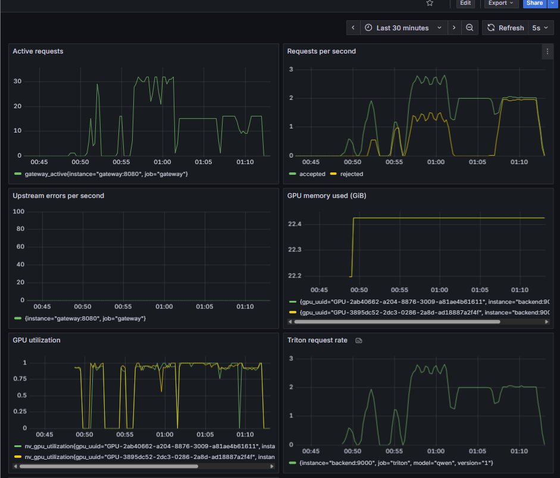
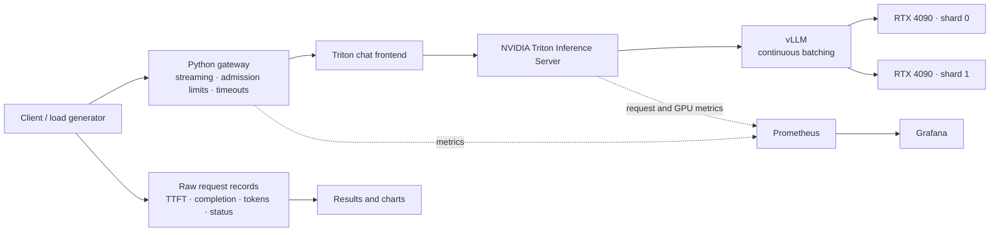
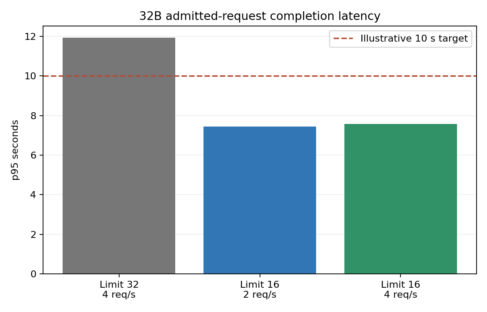
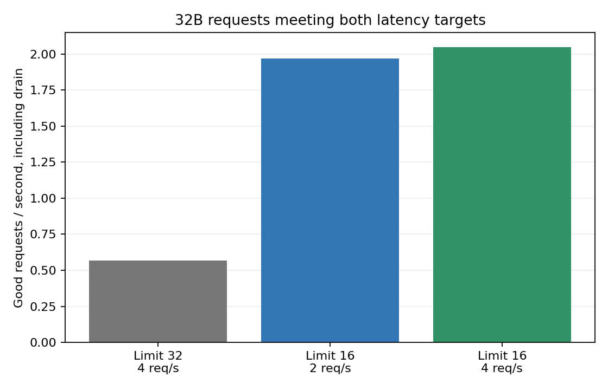
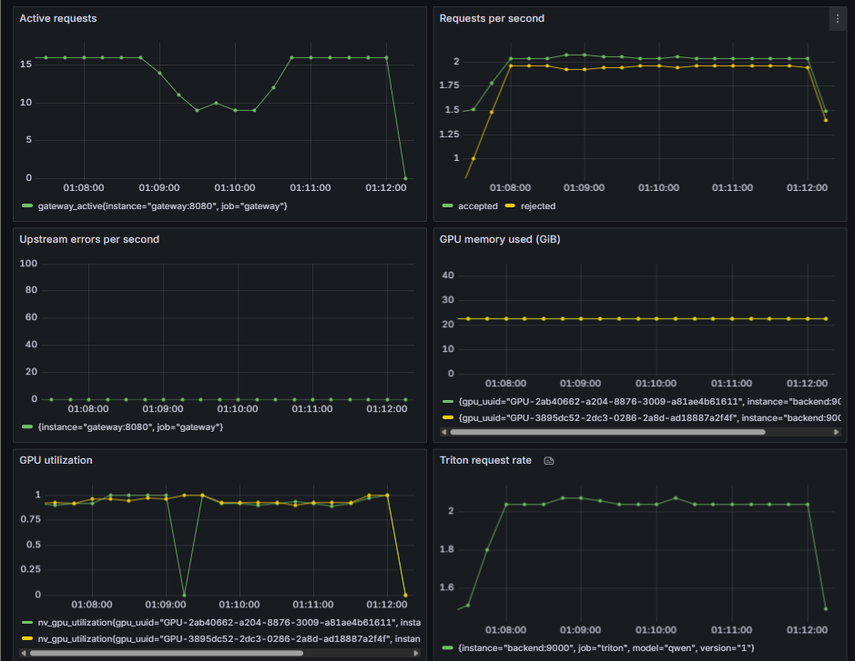
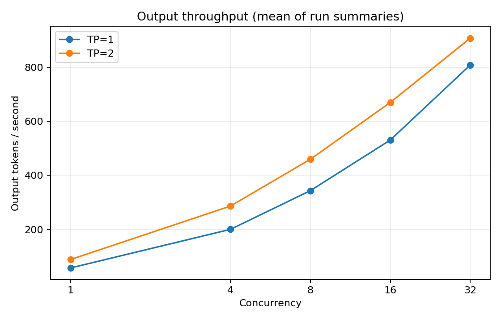
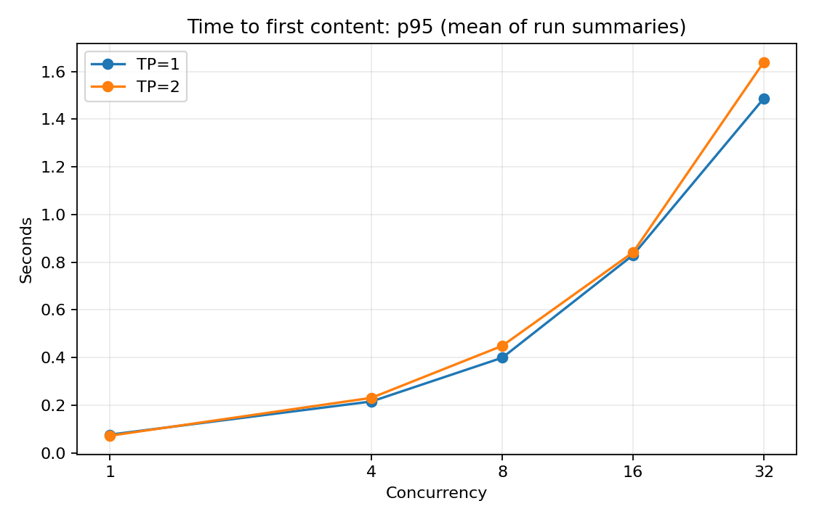

# Multi-GPU LLM Inference Gateway

A streaming inference gateway built around NVIDIA Triton Inference Server and vLLM. It runs Qwen2.5-32B with 8-bit GPTQ weights across two RTX 4090s, bounds active requests, rejects overload, and exposes serving and GPU metrics through Prometheus and Grafana.

**Measured result:** at the same offered load of **4 requests/s**, lowering the admission limit from **32 to 16** cut successful-request p95 completion latency **36.5%**, from **11.93 s to 7.58 s**. The rate of requests meeting both latency targets increased **3.60x**, with more rejections and lower total token throughput.

[Results and raw data](../results/README.md) · [32B experiment](../results/32b-admission/report.md) · [Reproduction guide](../docs/32b-experiment.md) · [Runbook](../docs/runbook.md)



*Captured from the rented host on November 9, 2026. The left portion includes calibration; the three long runs follow. Latency percentiles below come from individual client records, not dashboard estimates.*

## How it works



- **Serve:** stream chat completions through Triton's bundled frontend and official vLLM backend. Tensor parallelism shards one model across two GPUs; vLLM handles continuous batching.
- **Protect:** bound active upstream requests per gateway process, reject excess requests immediately with HTTP 429, validate request bodies, and apply an upstream inactivity timeout. Capacity is released after completion or upstream failures.
- **Observe:** scrape active requests, accepted/rejected traffic, upstream errors, Triton request rates, and GPU memory/utilization. The client separately measures first-content latency, completion latency, token throughput, and failures.
- **Reproduce:** pin container digests and model revisions, retain raw records and resolved configurations, and regenerate results without renting GPUs.

The gateway is a small standard-library Python HTTP proxy. NVIDIA supplies the chat frontend and inference engine; the custom work is admission control, streaming proxy behavior, validation, instrumentation, and the experiment tooling. NVIDIA Triton Inference Server is distinct from the Triton GPU kernel language.

## Results: protecting the 32B service under load

**Model:** Qwen2.5-32B-Instruct-GPTQ-Int8, using 8-bit GPTQ weights and the GPTQ Marlin kernel. **Hardware:** two 24 GiB RTX 4090s on one Vast VM, TP=2, PCIe host-bridge topology, no CPU offload. Startup logs report **16.36 GiB of model weights per GPU**; observed GPU allocation during serving was about **22.4 GiB per GPU**, including runtime/cache allocations.

Each case used five minutes of evenly spaced arrivals, four excluded warmups, 506–513 input tokens, and 128 output tokens per successful request. The illustrative targets were **500 ms to first content** and **10 s to completion**, both measured from scheduled dispatch. Model and engine settings stayed fixed; only the gateway admission limit changed between the two 4 req/s cases.

| Admission limit | Offered load | Completed / offered | Rejected (429) | p95 first content | p95 completion | Met both targets / offered | Output tokens/s |
|---:|---:|---:|---:|---:|---:|---:|---:|
| 32 | 4 req/s | 800 / 1,200 | 400 | 318 ms | 11.93 s | 173 / 1,200 (14.4%) | 336.6 |
| 16 | 2 req/s | 599 / 600 | 1 | 267 ms | 7.44 s | 597 / 600 (99.5%) | 252.7 |
| 16 | 4 req/s | 624 / 1,200 | 576 | 312 ms | 7.58 s | 622 / 1,200 (51.8%) | 262.9 |

**The tradeoff:** at 4 req/s, admitting less work reduced competition inside the serving engine. The rate meeting both targets rose from **0.569 to 2.048 requests/s**, including drain time. Rejections rose from **33.3% to 48.0%**, and total output throughput fell from **336.6 to 262.9 tokens/s**. Both configurations used admission control and continuous batching; this comparison measures a tighter admission limit.

At 2 req/s, **597 of 600 offered requests met both targets**. One request was rejected and two successful requests missed the first-content target. All 2,023 successful responses across the three cases had token counts matching independent tokenization of their decoded text.

<table>
  <tr>
    <td></td>
    <td></td>
  </tr>
</table>

[Full methodology, exact values, and limitations →](../results/32b-admission/report.md)

### What the dashboard shows



*Final five-minute overload window, approximately 01:07–01:12 America/Chicago. Active requests remain at or below 16, while excess requests are rejected. Grafana request rates use rolling one-minute windows; raw client records determine the reported counts and latency targets. GPU utilization is shown as a fraction, where 1.0 means 100%.*

## Separate study: one GPU versus two

The smaller **Qwen2.5-7B-Instruct** fits on one GPU, so it was used for a matched TP=1 versus TP=2 study. Both modes ran sequentially on the same two-GPU host, at concurrency 1, 4, 8, 16, and 32, with two repetitions of 50 requests per point. Of 1,000 offered requests, 999 completed and one returned 429.

At concurrency 32, TP=2 increased mean output throughput from **808 to 908 tokens/s**, while mean per-run p95 first-content latency increased from **1.49 to 1.64 s**. This shows why higher throughput alone does not select the best configuration. It compares one single-GPU instance with one two-GPU sharded instance; two independent single-GPU replicas were not tested.

<table>
  <tr>
    <td></td>
    <td></td>
  </tr>
</table>

[TP study and raw records →](../results/7b-tensor-parallel/report.md) · [Additional engine sequence-capacity experiment →](../results/7b-sequence-capacity/report.md)

## Try it locally without a GPU

The gateway and load generator require **Python 3.10+**, with no runtime Python packages. Docker Compose also starts a deterministic mock backend, Prometheus, and Grafana:

```sh
docker compose up -d --build
python benchmarks/run_load.py --workload workloads/prompts.json --warmup 2 --requests 20 --concurrency 4 --include-usage --output results.jsonl
python -m unittest discover -s tests -v
```

Open **Grafana at http://localhost:3000** and select **Inference Gateway → Gateway overview**. Initial credentials are `admin` / `admin`; change them if retaining the installation. Prometheus is at http://localhost:9090 and the gateway is at http://localhost:8080. Mock token counts and timings are synthetic functional checks.

Send a streaming request:

```sh
curl -N http://localhost:8080/v1/chat/completions \
  -H 'Content-Type: application/json' \
  -d '{"model":"qwen","messages":[{"role":"user","content":"Explain tensor parallelism in one sentence."}],"stream":true,"max_tokens":64}'
```

The curl example uses a POSIX shell. On Windows, run the Python benchmark from PowerShell or use WSL for the shell examples. Stop the mock stack with `docker compose down` before starting the GPU stack on the same ports.

Without Docker, run `python -m tests.mock_upstream` and `python -m gateway.server` in separate terminals, then run the benchmark in a third.

## Reproduce the published analysis

No GPU or cloud account is needed. The repository includes individual request records, summaries, measured configurations, captured source, logs, and telemetry for the published experiments.

```sh
python -m pip install -r requirements-analysis.txt
python scripts/verify_results.py
python benchmarks/analyze_32b.py results/32b-admission
python benchmarks/report.py results/7b-tensor-parallel --hourly-rate 0.982 --ttft-slo-ms 250 --latency-slo-ms 5000
python benchmarks/analyze_arrival.py results/7b-sequence-capacity
```

The 7B cost estimate uses the historical **$0.982/hour whole-instance offer**, pending invoice confirmation. It excludes startup, idle time, storage, bandwidth, and taxes. The 32B session's actual rate and total spend are unverified, so no 32B cost result is claimed. See [the evidence index](../results/README.md) for file provenance and definitions.

## Run on two GPUs

Use a Linux host with two compatible GPUs, working NVIDIA drivers, NVIDIA Container Toolkit, and Docker Compose with GPU support. The measured 32B host used driver **580.95.05**, Docker **28.1.1**, and Compose **2.35.1**. Other hosts require their own compatibility and readiness checks. Allow disk space for both the large container and model download; the measured VM had a 126 GB root disk.

The stack pins Triton **25.08**, its bundled vLLM **0.9.2**, and the matching frontend in one container digest. Model revisions are also pinned. The 32B overlay is required: the base GPU file defaults to a small smoke-test model.

```sh
MAX_ACTIVE=16 docker compose -f compose.gpu.yaml -f compose.32b.yaml up -d --build
docker compose -f compose.gpu.yaml -f compose.32b.yaml logs -f backend
```

Wait for model readiness and a successful streaming smoke request. Gateway `/healthz` checks only its own process. First startup downloads the checkpoint; download and initialization time are billed on a rented host.

```sh
python benchmarks/run_load.py --model qwen --workload workloads/prompts-512.json --warmup 1 --requests 1 --concurrency 1 --include-usage --output results.jsonl
```

Follow the [32B reproduction guide](../docs/32b-experiment.md) for the complete three-case experiment and evidence export. Keep services on loopback and connect through SSH tunnels. After exporting results, terminate the rental through the provider and check for remaining storage charges; stopping Docker does not stop rental billing.

## Repository map

| Path | Purpose |
|---|---|
| [`gateway/server.py`](../gateway/server.py) | Streaming proxy, active-request admission, validation, metrics |
| [`deploy/start_backend.py`](../deploy/start_backend.py) | Pinned model snapshot and bundled Triton frontend launcher |
| [`compose.gpu.yaml`](../compose.gpu.yaml), [`compose.32b.yaml`](../compose.32b.yaml) | GPU serving stack and measured 32B configuration |
| [`benchmarks/`](../benchmarks/) | Closed-loop and fixed-arrival clients, analysis and plotting |
| [`monitoring/`](../monitoring/) | Provisioned Prometheus scrapes and Grafana dashboard |
| [`workloads/`](../workloads/) | Fixed synthetic prompts |
| [`results/`](../results/README.md) | Published measurements, captured source, charts, and reports |
| [`docs/`](../docs/) | Runbook, reproduction guide, screenshots, project status |

## Scope and remaining work

The gateway implements a narrow chat-completions proxy, with streaming and non-streaming responses. It does not implement the full OpenAI API, authentication, TLS, distributed rate limits, or high availability. The current source adds bounded connection handlers, inbound inactivity limits, a total connection deadline, and opt-in chat-template token limits alongside the byte cap. It rejects immediately rather than maintaining a waiting queue. The published GPU measurements used the earlier captured source with byte limits and upstream inactivity timeouts; they do not validate these later extensions. See [optional extensions](../docs/optional-extensions.md) for settings, tests, and deadline limitations.

These are bounded synthetic experiments on rented hosts. The 32B comparison has one five-minute run per case, uniform arrivals, fixed prompts, and sequential trial order. It does not establish a production SLA, a maximum sustainable rate, the isolated effect of continuous batching, or quantization quality. The 32B model was not measured at TP=1. Client latency results describe the measured host path, not arbitrary internet clients.

The serving and measurement work is complete for this study. The remaining closeout items are to confirm rental termination and actual charges. Local tooling is now available for repeated/reordered admission trials, bursty and Poisson arrivals, longer prompts, and two TP=1 replicas versus one TP=2 instance. Those new GPU experiments remain unmeasured. See the [extension runbook](../docs/optional-extensions.md) and [project status](../docs/project-status.md).
