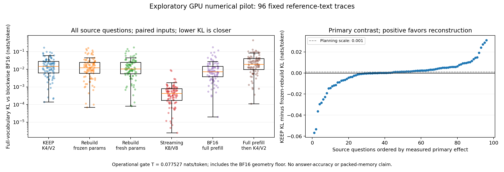

# Reconstructing low-bit KV histories: no demonstrated mean benefit in a controlled numerical pilot

Technical report · November 13, 2026 local time / November 14 UTC · exploratory negative result

## Abstract

Can recomputing an identical token prefix reduce the numerical distortion caused
by reading a compressed KV cache? We test this question while holding the
quantizer parameters and execution block sizes fixed. The experiment uses a
1.5B reasoning model, a pinned KVarN reference adapter, 384-token reference-text
prefixes, and full-vocabulary next-token KL on identical teacher-forced probes.
A four-question CPU pilot suggested a 33.37% reduction in mean KL. On 96 new GPU
questions, the prespecified mean benefit was instead −0.000424 nats/token, with an
exploratory question-bootstrap 95% interval of [−0.003191, 0.002168]. Reconstruction
improved 60 questions and worsened 36; larger regressions offset the more frequent
improvements. Independent BF16 rebuild repeats were exact, while parallel-prefill
and blockwise histories disagreed. The unchanged operational gate stops expansion.
The study demonstrates neither answer-accuracy recovery nor absence of a useful
effect. Its contribution is a bounded, auditable test with released evidence,
including results that did not support the initial mean improvement.

## 1. Question, hypothesis and claim boundary

An autoregressive model saves keys and values from earlier tokens so it can reuse
them without replaying the entire prefix. Low-bit storage reduces the size of
that cache. Reading an approximate history can also change the hidden states
written for later tokens. Rebuilding from the original tokens could therefore
change two things: the states being encoded and the parameters used to encode them.

The practical motivation is long-context or concurrent inference, where KV memory
can matter substantially. **This pilot does not test that operating regime.** It
isolates a numerical intervention on short, fixed prefixes before considering a
runtime policy or an expensive accuracy study.

The primary hypothesis was that replacing history-corrupted states with states
reconstructed from an uncompressed history, while holding the old encoding
parameters fixed, would yield a material mean reduction in continuation KL.
Holding parameters fixed prevents improved scale estimation from being counted
as a state-reconstruction gain. It also makes the intervention a diagnostic:
old parameters may fit the old states better than the reconstructed states.

| Claim | What this study supports |
|---|---|
| Frozen-parameter reconstruction improves mean KL | Not demonstrated on the 96-question cohort |
| Reconstruction never helps | Not supported; effects are heterogeneous and the mean interval is wide |
| The four-case CPU percentage generalizes | Not supported by this GPU cohort |
| Repeated execution and execution geometry are interchangeable controls | Not supported: repeats were exact, geometry changes were not |
| Answers become more accurate, inference becomes faster, or physical memory falls | Not evaluated |
| The same outcome holds for long generated chains or native KVarN kernels | Not evaluated |

This is a technical report, not a claim of peer review, priority, or conference
acceptance. Better presentation cannot supply the missing long-context, accuracy
or native-kernel evidence.

## 2. Related work and what is different here

[KVarN](https://arxiv.org/abs/2606.03458) studies accumulation during decoding and
identifies token-scale errors as a central cause. Its rotation and dual-axis
normalization make it a more relevant starting point than a naive uniform
quantizer. Here we use an adapter to pinned reference routines, with explicit
precision differences from the native serving backend.

[RECAP](https://arxiv.org/html/2610.15259v1) already uses teacher-forced cache-unit
restoration diagnostics and rebuilds history during post-training calibration.
Thus neither cache repair diagnostics nor historical-context reconstruction is
a new general idea. Our narrower question concerns a fixed-prefix state/parameter
decomposition without training or calibration updates.

[KIVI](https://arxiv.org/abs/2402.02750) retains a recent full-precision residual
window. [Kitty](https://arxiv.org/html/2511.18643v1) studies sink preservation and
selective precision increases for keys. Those are important allocation competitors
for a practical repair policy; they were not implemented as matched-budget arms here.

[Spend Bytes on Breadth](https://arxiv.org/html/2610.05685v1) studies precision/count
trade-offs under fixed byte budgets and documents the limited predictive value of
local distortion for end-to-end performance. It motivates our refusal to equate
KL improvement with answer improvement.

[ZipCache](https://arxiv.org/html/2405.14256v1), Appendix B, periodically recompresses
stored K/V. [XQuant](https://arxiv.org/abs/2508.10395) rematerializes K/V from stored
layer inputs, while [KVShare](https://arxiv.org/abs/2503.16525v2) selectively
recomputes cache states in a reuse setting. These limit broad novelty claims about
refreshing caches or trading compute for memory. We do not claim the first repair
method or an exhaustive novelty audit. No released comparator was reproduced
end to end in this pilot.

## 3. Experimental design

### 3.1 Model, data and frozen cohort

| Item | Fixed setting |
|---|---|
| Model | `deepseek-ai/DeepSeek-R1-Distill-Qwen-1.5B` |
| Model revision | `ad9f0ae0864d7fbcd1cd905e3c6c5b069cc8b562` |
| Weight SHA-256 | `58858233513d76b8703e72eed6ce16807b523328188e13329257fb9594462945` |
| Data | `HuggingFaceH4/MATH-500`, revision `6e4ed1a2a79af7d8630a6b768ec859cb5af4d3be` |
| Original dataset-file SHA-256 | `35dc41080a3680858b27fa7e0533d2d547825316fc5dafe5d316f4ccc5a06132` |
| Prefix / probe | 384 tokens / 16 further teacher-forced input tokens |
| History block size | 32 tokens; full-prefill controls use one 384-token block |
| Model computation | BF16, eager attention, evaluation/inference mode, seed 0 |
| Quantizer | K4/V2, group size 128, first 128 tokens retained in BF16 |
| Normalization | Eight iterations, min/max range, FP32 Hadamard rotation, FP16 stored scales |
| GPU cohort | 96 unique source questions, excluding the four CPU development questions |

For each question, the sequence concatenates the tokenizer's user chat template
with the dataset's reference solution. Selection follows sorted SHA-256 of the
source ID, retaining eligible sequences of at least 400 tokens. The first four
eligible questions formed the CPU pilot; the GPU cohort consists of the first
96 remaining eligible questions. Selection used no model scores. Exact token
arrays, their hashes, revisions and settings are in [specs/](specs/).

The two workers receive alternating questions in that order: `[0::2]` and `[1::2]`,
48 each. Every intervention for one question runs on one GPU. All 96 completed
once. There were no substitutions, additional seeds counted as independent
questions, or model/bit-width searches. Four CPU cases were replayed on CUDA as
an engineering smoke, outside the primary GPU denominator.

These are **reference-text prefixes**, not generations from either compressed or
uncompressed decoding. The length filter and one benchmark limit generalization.
The prefix may contain problem text as well as solution text; we do not assert
that all 384 tokens are generated reasoning.

### 3.2 State/parameter decomposition

Let S denote the raw K/V states written while reading an uncompressed history,
and C those written while reading compressed history. Both histories use the
same 32-token blocks, masks and positions. Let Q_C and Q_S denote encoding with
normalization, range and rounding parameters derived from C or S, respectively.

| Cell | History states | Encoding parameters | Interpretation |
|---|---|---|---|
| Q_C(C), KEEP | C | From C | Low-bit-history baseline |
| Q_C(S), primary reconstruction | S | Frozen from C | Conditional effect of replacing states |
| Q_S(C) | C | From S | Oracle parameter-only diagnostic |
| Q_S(S) | S | From S | Reconstructed states and fresh parameters |

The adapter quantizes complete post-sink 128-token tiles after each block and
retains an incomplete tail in BF16. At the checkpoint, 128 sink tokens remain
unquantized and 256 tokens occupy two quantized tiles. The first complete
post-sink tile is encoded after 256 prefix tokens; only the final 128 prefix
tokens can read quantized history in this setup. This is a particularly short
test of accumulation, not a proxy for tens of thousands of decode steps.

Frozen parameters include full-precision diagnostic operator parameters that are
not all retained in a deployable packed record. Q_C(S) is therefore a mechanism
probe, not an implementation of a memory-saving production repair. Keeping
parameters fixed defines a conditional intervention; it does not give a unique
additive attribution of every error to either history or scales.

The adapter executes pinned official pure-PyTorch routines from KVarN commit
`7586257f1c632e63187bfacbbe21ccb51540f7b3`. It replaces the store module's unavailable
vLLM import with the same official normalization reference. Its rotation is FP32
and model computation BF16, whereas the native backend uses a different precision
path. Packed records are constructed, then dequantized for BF16 attention. We
have **not validated numerical equivalence to native packed-attention kernels**.

### 3.3 Probe and metric

Every arm receives the same 16 continuation input IDs. A cloned prefix cache is
extended by a BF16 probe block; these new probe states are not low-bit quantized.
The returned cache is discarded. The experiment measures the effect of the old
prefix cache on this probe, not sustained low-bit continuation.

At each probe input position, the model supplies its next-token distribution.
The first measured distribution is after the first probe input, rather than
immediately at the checkpoint. All vocabulary entries are included. With P_S
the blockwise BF16 reference and P_a an intervention, define

```text
D_i(a) = (1/16) Σ_t KL(P_S,i,t || P_a,i,t)
B_i    = D_i(KEEP) - D_i(Q_C(S)).
```

Positive B favors reconstruction. Log-softmax is computed in FP32 and the KL
accumulation in FP64, following the frozen runner. Each source question supplies
one paired observation. Tokens, layers, arms and repeat executions are not
additional independent observations. KL measures proximity to the chosen
reference distribution; that reference is not a correctness oracle.

### 3.4 Controls and fixed additional arms

Two independent blockwise BF16 histories and two independent full-prefill BF16
histories are constructed per question. Their probe distributions test replay
determinism within each geometry. A separate repeated probe of an unchanged cache
tests the narrower readout operation. We also compare full prefill against the
blockwise BF16 reference, and quantize the full-prefill cache before probing.

On every GPU question, re-encoding C with its own frozen parameters must reproduce
KEEP exactly. Per-layer K/V relative squared L2 errors are retained for raw
histories and all arms. This identity checks the encoder decomposition, not all
native-backend behavior or cross-process determinism.

One fixed higher-precision numerical anchor uses streaming K8/V8 with the same
group, sink/tail and block policies. Its task-accuracy cost is unvalidated; it
cannot calibrate KL into an accuracy guarantee. No other widths were searched.

### 3.5 Uncertainty and operational decision rule

The primary summary is the paired arithmetic mean of B. A whole-question
percentile bootstrap uses 20,000 draws, NumPy `default_rng` seed 20261113, and a
95% interval. All arms of a question remain together. These intervals are
exploratory and conditional on the length-filtered benchmark cohort.

Prespecified secondary reporting includes fresh-minus-frozen mean KL and its
paired interval, the median primary benefit, sign counts, and mean
`log(KEEP KL / frozen KL)`. The latter uses a 1e-9 floor with a reported clipping
count. Leave-one-question-out means diagnose sensitivity. Secondary intervals
are not multiplicity-adjusted discoveries and cannot replace the primary endpoint.

The rule, fixed after CPU development but before GPU scoring, is retained in
[the global specification](specs/gpu.json) and [executed source](evidence/source-gpu/numerical_gate.py):

1. Any repeat absolute mean KL above 1e-6 invalidates the controls.
2. F is the larger of mean repeat discrepancy and mean absolute
   full-prefill-versus-blockwise BF16 KL. T = max(0.001, 5F) nats/token.
3. If mean KEEP KL is at most T, stop under the operational target screen.
4. Continue only to designing a new study if the lower primary interval endpoint
   exceeds T. If the upper endpoint is below 0.001, stop for insufficient numerical
   benefit. Otherwise report inconclusive and do not expand automatically.

The 0.001 scale was a planning target, not an established threshold for useful
accuracy. F includes a geometry intervention, which is not sampling noise in
the matched-geometry primary contrast. Consequently this conservative veto may
reject an interpretable state effect; **5F is not an additive KL error bound**.
The rule determines this pilot's next action, not a universal scientific verdict.

## 4. Results

### 4.1 Development, smoke and independent cohort

| Population | N | Mean KEEP KL | Mean frozen KL | Mean benefit |
|---|---:|---:|---:|---:|
| CPU development | 4 | 0.0112423 | 0.0074908 | 0.0037515 |
| Same four, CUDA smoke | 4 | 0.0090807 | 0.0076681 | 0.0014126 |
| New CUDA cohort, primary | 96 | 0.0229945 | 0.0234188 | **−0.0004243** |

All values are nats/token. The CPU 33.37% figure is
`1 - mean(frozen KL)/mean(KEEP KL)`, not a mean of per-question percentages.
The CPU mean fresh-minus-frozen difference was only 0.0000405, with mixed signs.
It supplied no convincing evidence that one parameter policy was better.

| CPU source question | KEEP KL | Frozen reconstruction | Fresh reconstruction |
|---|---:|---:|---:|
| geometry/846 | 0.012589 | 0.009873 | 0.011398 |
| intermediate_algebra/2015 | 0.007036 | 0.006011 | 0.007396 |
| intermediate_algebra/1544 | 0.006708 | 0.004181 | 0.004195 |
| intermediate_algebra/558 | 0.018636 | 0.009898 | 0.007136 |

Question 558 contributed 58.23% of the CPU total benefit. A normal approximation
using the four-case SD of 0.003410 suggested nominal N=92 for a 0.001 effect;
96 were selected. The GPU paired SD was 0.013393, about 3.93 times larger. That
planning calculation was not reliable power analysis. Both cohort and backend
changed, so attributing the discrepancy solely to a small-sample fluke would also
go beyond the evidence. The same-case CUDA smoke helps expose this distinction.

### 4.2 Primary outcome and heterogeneity

| Measure on 96 independent questions | Value |
|---|---:|
| Mean benefit, primary | **−0.0004243** |
| Exploratory 95% interval | **[−0.0031908, 0.0021675]** |
| Median benefit | 0.0011817 |
| Improved / unchanged / worsened | 60 / 0 / 36 |
| Leave-one-out mean range | [−0.0007569, 0.0001684] |
| Mean log KL ratio | 0.144721 |
| Exploratory interval for mean log ratio | [0.028113, 0.263375] |
| Log-ratio clipping count | 0 |

The arithmetic mean provides no demonstrated benefit. The favorable median,
sign count and relative summary describe a different aspect of the distribution:
improvements are more frequent, but harmful tails outweigh them in absolute KL.
It would be selective reporting to promote those summaries after the mean failed.
Conversely, the mean interval includes zero and benefits above 0.001; the data
do not establish equivalence or prove that repair is useless.



*Figure 1. Each dot is a source question. Left: cache/probe conditions measured
against blockwise BF16, on a logarithmic scale; boxes show the distribution and
median, not confidence intervals. Right: all primary effects sorted for display.
The dashed line is the original planning scale. The actual operational T, stated
below the figure, additionally includes the geometry control.*

### 4.3 Secondary cells and anchor

| Arm | Mean KL vs blockwise BF16 |
|---|---:|
| KEEP, Q_C(C) | 0.0229945 |
| Frozen reconstruction, Q_C(S) | 0.0234188 |
| Oracle parameter-only, Q_S(C) | 0.0240005 |
| Fresh reconstruction, Q_S(S) | 0.0209484 |
| BF16 full prefill | 0.0155054 |
| Full prefill, then K4/V2 | 0.0343060 |
| Streaming K8/V8 anchor | 0.0007184 |

The prespecified fresh-minus-frozen contrast is −0.0024704, with interval
[−0.0053946, 0.0001265]. Its point estimate favors fresh parameters, but the
interval includes zero. We cannot establish a universal ordering between the
policies, or uniquely assign the observed differences to bad scales or bad history.

Frozen reconstruction has higher KL than the K8/V8 anchor on all 96 questions.
Mean frozen-minus-anchor KL is 0.0227004, interval [0.0168095, 0.0292559].
At this checkpoint, logical storage is 13,589.3 bytes/prefix-token for K4/V2 and
19,562.7 for K8/V8, including sink/tail/metadata. The anchor spends more bytes;
this is not a matched-memory Pareto comparison or an accuracy result.

### 4.4 Controls and the unchanged gate

All independent repeat and unchanged-cache probe KLs are exactly zero at the
recorded precision. Frozen-parameter self-encoding error is also exactly zero.
All 16 position values and 28-layer diagnostics are present. Raw layer-zero
compressed-history state error is zero, consistent with identical inputs before
history-dependent attention affects subsequent layer states.

However, mean BF16 full-prefill-versus-blockwise KL is 0.0155054. Repetition is
stable while the two execution geometries differ. This is a control observation,
not proof of a particular kernel bug, answer instability, or batching mechanism;
an independent implementation audit would be needed for those claims.

The gate therefore sets F=0.0155054 and T=0.0775271. Since mean KEEP KL=0.0229945
is below T, it returns `no_material_numerical_target_stop`. **This label describes
the conservative screen, not absence of quantization distortion.** The primary
interval also fails the continue condition. We leave the rule unchanged and stop
automatic expansion rather than recalibrate it using these outcomes.

## 5. Resources and reproducibility

The supplied host had two RTX 4090s with 24 GB each, rather than the initially
offered 5090s. This was recorded before scoring. The GPU environment used Python
3.10, PyTorch 2.7.1+cu128, Transformers 4.49.0 and NumPy 2.1.3. BF16 matrix-kernel
checks passed on both devices. TF32 matmul was disabled in the model runner.
[Captured packages and hardware](evidence/environment/) provide the fuller record.

The launcher ran from 01:21:51Z to 01:29:55Z: 8 min 04 s, including checkpoint
fetch and smoke. Sum of GPU-cohort case wall times was 742.74 s across both
devices; smoke case times added 32.11 s. Peak measured allocation was
3,876,609,536 bytes and reservation 4,095,737,856 bytes, including model weights
and diagnostic buffers. These are complete diagnostic-run quantities, not the
cost of a deployable repair action or physical low-bit cache savings. CPU
disk-offload runtime and environment setup are separate. Rental spend and energy
were not measured. Both workers exited zero; all results were exported locally.

Run the offline check from the repository root:

```sh
python -m pip install -r requirements-research.txt
python -m research.cache_repair.reproduce
```

This verifies all 41 checksummed evidence/specification/figure files, exact token
and source hashes, disjoint development/evaluation questions, alternating shards,
completion, per-position means, and recomputed CPU/GPU statistics. NumPy is
sufficient for that command; the requirements file also supports the other
research tests and plotting. No network, model weights or GPU is needed after
dependency installation.

The [evidence](evidence/) contains raw manifests, all individual effects, original
analyses and executed-source snapshots. The [checksums](SHA256SUMS) preserve exact
capture bytes across platforms. Current maintained code may differ from the
executed snapshots; we do not rewrite historical provenance after refactoring.
The original result and transfer archive hashes are in
[provenance.json](evidence/provenance.json); the draft-filled archives themselves
are not needed in the public repository.

For an optional model replay or a new study, use the
[experiment workflow](../../docs/research-workflow.md). Recomputing saved
statistics is a different claim from independently reproducing model inference
on another host.

## 6. Limitations and remaining evidence gaps

1. **No accuracy endpoint.** There are no generated answers, executable answer
   scores, recovery fractions or selected-answer sampling comparisons. KL and
   layer error cannot establish reasoning quality.
2. **Short, clean prefixes.** One 384-token checkpoint, a 16-token BF16 probe and
   reference solutions do not test long-horizon accumulation, compressed-origin
   textual mistakes, repeated repair, or a triggering policy.
3. **One model and one effective low-bit setting.** No independent second-model,
   second-backend or native-kernel replication supports generalization.
4. **Diagnostic implementation.** Extra raw states and FP32 operators are available
   only to the experiment. There is no demonstrated packed-memory saving or
   deployment-quality/bytes/time frontier.
5. **Missing practical comparators.** Recent-window allocation, mixed precision,
   equal-byte higher precision, equal-compute selected-answer resampling and
   alternative runtime repair methods remain untested.
6. **Uncertain inference.** The bootstrap is exploratory, the benchmark is filtered,
   and the mean interval permits useful benefits as well as harms. Secondary
   intervals are not corrected for multiplicity. No equivalence margin was tested.
7. **Control scope.** Repeats are within process. No independent compressed-history
   full-run repeat, cross-device same-question test, or separate implementation
   eliminates every possible numerical artifact. Encoder identity alone cannot
   substitute for those tests.
8. **Conservative operational rule.** Geometry discrepancy is included in the
   screen although geometry is matched in the primary comparison. Its threshold
   can veto a study without identifying the physical cause of the measured error.

The report's central statement is consequently narrow: **this fixed pilot did
not demonstrate a mean numerical benefit from frozen-parameter reconstruction**.
It is not evidence that reconstruction never helps, that native KVarN is defective,
or that GPU numerical path differences predict answer errors beyond logit margin.

## 7. Decision and research record

Do not expand this configuration automatically or start an accuracy study on the
strength of the CPU percentage. A future experiment must state a new question,
justify a relevant context regime, account for regressions and practical budgets,
and freeze its comparison before collecting new data. The separate batch-wobble
question remains [unanswered](../batch-instability/report.md).

Before GPU scoring, the study was amended to prioritize the strong quantizer
reference, fix the source-question KL endpoint, add independent BF16 repeats and
the operational gate, then add the K8/V8 anchor and robustness/secondary summaries.
The 96-question roster did not change. No GPU score preceded those amendments.
CPU observations were development evidence, not a preregistered confirmation.
Machine-readable frozen settings and executed source provide the auditable record;
private planning journals are intentionally excluded from the release.

## Appendix: reporting and asset disclosures

The report follows the intent of the [NeurIPS paper checklist](https://neurips.cc/public/guides/PaperChecklist):
claims are bounded by the tested setting; limitations and uncertainty are explicit;
data, settings, source and compute records are available. It is not a completed
conference submission or evidence that the study meets a conference's significance
or originality bar.

No model was trained or fine-tuned. Public benchmark mathematics supplied the
reference text; no human participants or private user data were used. Model
weights are not redistributed. The [pinned model card](https://huggingface.co/deepseek-ai/DeepSeek-R1-Distill-Qwen-1.5B/blob/ad9f0ae0864d7fbcd1cd905e3c6c5b069cc8b562/README.md)
identifies the model license. The [dataset card](https://huggingface.co/datasets/HuggingFaceH4/MATH-500)
identifies MATH-500's source. Included official quantizer source retains its
Apache-2.0 notices and [license](evidence/upstream/LICENSE).

An AI coding assistant helped design, implement, execute and document the pilot.
Released measurements come from the saved manifests; generated prose is not
experimental evidence. No independent human review or independent laboratory
replication is claimed. The main risk of misusing this report is turning numerical
closeness, a failed gate, or a short-context observation into an unsupported claim
about answer correctness or deployed reliability.
