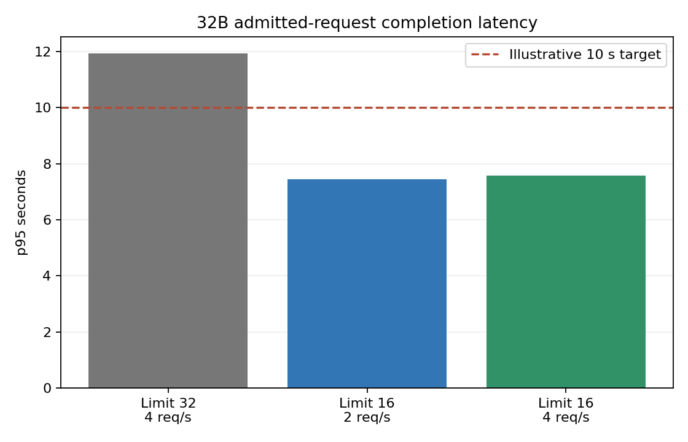
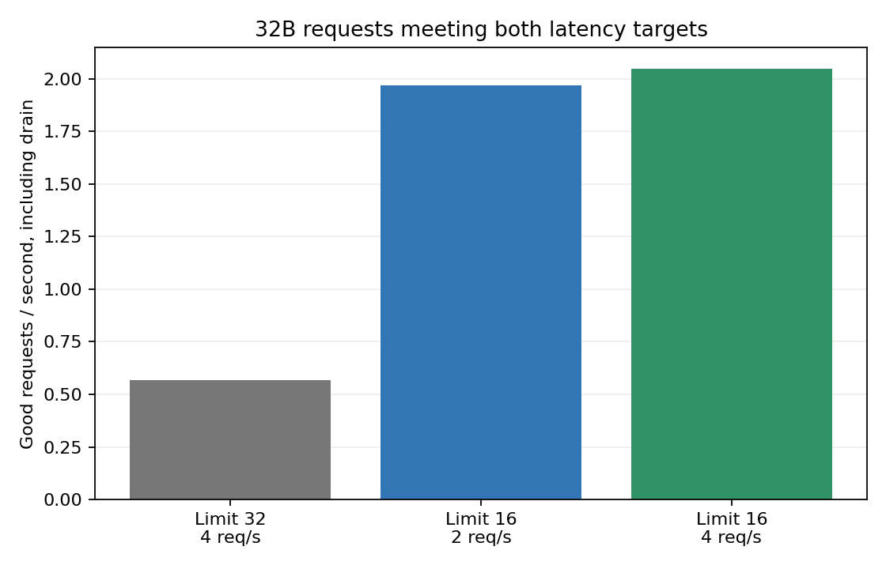

# 32B gateway admission-control experiment

On two RTX 4090 GPUs, reducing the gateway admission limit from 32 to 16 under the same 4 requests/s workload reduced successful-request p95 completion latency **36.5% (11.93 s to 7.58 s)** and increased latency-qualified goodput **3.60x (0.569 to 2.048 requests/s)**. This trades greater rejection for lower latency: HTTP 429 responses increased from 33.3% to 48.0%, and gross output throughput decreased from 336.6 to 262.9 tokens/s.

## Workload and deployment

- Model: **Qwen/Qwen2.5-32B-Instruct-GPTQ-Int8**, revision `eddc13f573fd3648cc8a4741fdf1b70e8d6fc5c1`. These are **8-bit quantized** results; model quality was not evaluated.
- Hardware: 2x RTX 4090, 24 GiB per GPU, tensor parallelism 2, no CPU offload. Startup logs report 16.3584 GiB of model weights per GPU. The checkpoint contains 35,068,693,560 weight bytes, exceeding one GPU's memory.
- Serving: pinned Triton 25.08 / vLLM 0.9.2 image, GPTQ Marlin, engine `max_num_seqs=32`, maximum model length 2048, GPU memory utilization setting 0.90. Gateway admission limit is the only setting changed between the matched overload cases.
- Eight fixed synthetic prompts, 506-513 input tokens, temperature 0, 128 output tokens per successful measured request. All 2,023 successful outputs' usage counts matched independent tokenization of their decoded text.
- Uniform fixed arrivals for **300 seconds per case**, with four sequential warmup requests excluded and outstanding requests allowed to drain. Three measured cases, 3,000 offered requests total.
- Illustrative targets selected before the pilots: **500 ms time to first content token and 10 s completion**. Both timings start at scheduled dispatch, including client dispatch delay. Successful-request percentiles exclude rejections; offered-request fractions and goodput retain them.
- Workload SHA-256: `47aec296b76eb16e063c0ab3a1ce58027d84108497d767c1952ba4c16cc9fe10`.

## Results

| Case | Offered | HTTP 200 | HTTP 429 | Within both targets | p95 TTFT | p95 completion | Target-qualified goodput | Output tokens/s |
|---|---:|---:|---:|---:|---:|---:|---:|---:|
| Limit 32, 4 req/s | 1,200 | 800 | 400 | 173 (14.4% offered) | 318 ms | 11.93 s | 0.569/s | 336.6 |
| Limit 16, 2 req/s | 600 | 599 | 1 | 597 (99.5% offered) | 267 ms | 7.44 s | 1.967/s | 252.7 |
| Limit 16, 4 req/s | 1,200 | 624 | 576 | 622 (51.8% offered) | 312 ms | 7.58 s | 2.048/s | 262.9 |

Goodput and token throughput use the full elapsed run including drain. There were no other HTTP statuses in the measured runs. At 2 req/s, one request was rejected and two successful requests exceeded the TTFT target (680 and 518 ms); both completed within 10 seconds. At 4 req/s with limit 16, two successful requests exceeded the TTFT target (778 and 528 ms); both completed within 10 seconds. Thus 622/624 admitted requests met both targets under overload, while rejections remain explicitly counted against offered traffic.

Per-minute successful-request p95 completion stayed between 11.83 and 11.99 s for the reference overload case, 7.39 and 7.47 s for the 2 req/s protected case, and 7.53 and 7.60 s for the protected overload case. Dispatch lag p99 was below 0.8 ms in every case, and the measured dispatch rates matched the configured rates.

## Validation and limits

The live gateway returned 413 for an oversized body, 400 for empty messages, and 200 for a non-streaming request after the overload drained. Prometheus targets, metric ranges, GPU samples, resolved configurations, server logs, source hashes, raw request records, and summaries are retained alongside this report. The local 11-test suite passed after analysis changes.

These are single five-minute runs per case on one rented host, executed sequentially. They demonstrate the admission-control tradeoff for this workload, not a production SLA, maximum sustainable capacity, or a causal measurement of continuous batching. The larger model was not compared at TP=1 because its checkpoint exceeds one GPU's memory. Earlier 7B TP=1 versus TP=2 results are a separate experiment. No inference-quality or quantization-quality evaluation was performed. Rental cost was not inferred from an earlier offer price.

## Reproduction and evidence

Recompute tables and charts from this directory with:

```sh
python benchmarks/analyze_32b.py results/32b-admission
```

See `run-long.sh` for the measured command sequence; `compose.32b.yaml`, `compose.gpu.yaml`, and each case's resolved Compose file for configuration; `analysis-32b.json` for exact values; and the corresponding `.jsonl` files for individual requests. `token-count-validation.json` records token checks, and `live-smoke-and-validation.json` records live validation.





## Resume wording supported by this experiment

Tuned admission control for a 32B INT8 inference gateway on 2 RTX 4090s, reducing p95 completion latency 36% and increasing latency-qualified goodput 3.6x under a fixed 4 requests/s workload.

Explain in an interview that qualified goodput required both 500 ms TTFT and 10 s completion, and that this improvement came with more HTTP 429 rejections and lower gross token throughput.


## Published evidence

This directory contains the captured measurement inputs selected for publication. See [the evidence index](../README.md) for file definitions and provenance. SHA256SUMS covers captured inputs; reports, generated analysis, and figures are excluded. Historical file paths in summaries and commands refer to the measurement VM.
