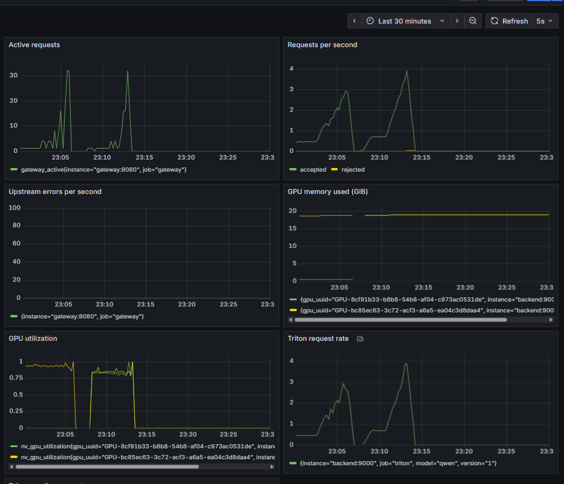

# 7B tensor-parallelism experiment

One Vast VM with 2x RTX 4090 (24 GiB each), NVIDIA driver 580.178.04, PCIe host-bridge topology. NVIDIA Triton Inference Server 25.08, bundled vLLM 0.9.2, Qwen2.5-7B-Instruct revision a09a35458c702b33eeacc393d103063234e8bc28. TP=1 and TP=2 were run sequentially on the same host. Two repetitions per point, 50 measured requests per repetition and four warmups. 1,000 measured requests: 999 completed and one HTTP 429 at TP=2, concurrency 32.

Eight fixed synthetic prompts, 506-513 template input tokens, maximum 128 output tokens, temperature 0. Token counts are server reported. Independently re-tokenizing the decoded outputs with the pinned tokenizer matched server completion-token counts for all 999 successes. TTFT is measured to first nonempty streamed content.

The p95 numbers below are the arithmetic mean of two per-run p95s, not pooled p95s. Throughput is mean of two per-run aggregate throughput values. Fifty requests per run make p95 estimates noisy, particularly at concurrency 32. TP=2 versus TP=1 is one sharded model versus one single-GPU model, not two independent replicas.

Cost estimates assume the screenshot rate of $0.982 per hour for the entire two-GPU instance, subject to confirmation in the provider invoice. They are steady-state compute estimates and exclude startup, idle time, storage, bandwidth and taxes. Actual spend has not been verified.

| TP | Concurrency | Successes / requests | Output tokens/s | Mean p95 TTFT (ms) | Mean p95 completion (s) | Est. compute $/1M output tokens |
|---:|---:|---:|---:|---:|---:|---:|
| 1 | 1 | 100/100 | 57.6 | 76.4 | 2.23 | 4.739 |
| 1 | 4 | 100/100 | 200.2 | 215.8 | 2.54 | 1.362 |
| 1 | 8 | 100/100 | 343.4 | 399.4 | 2.75 | 0.794 |
| 1 | 16 | 100/100 | 530.7 | 830.2 | 3.31 | 0.514 |
| 1 | 32 | 100/100 | 808.2 | 1487.7 | 4.45 | 0.338 |
| 2 | 1 | 100/100 | 88.7 | 72.1 | 1.45 | 3.076 |
| 2 | 4 | 100/100 | 286.4 | 231.1 | 1.80 | 0.952 |
| 2 | 8 | 100/100 | 459.5 | 449.3 | 2.13 | 0.594 |
| 2 | 16 | 100/100 | 669.8 | 841.5 | 2.68 | 0.407 |
| 2 | 32 | 99/100 | 907.5 | 1640.2 | 4.01 | 0.301 |

TP=1 concurrency 1-32 ran approximately 04:58-05:06 UTC; TP=2 ran approximately 05:08-05:13 UTC on 2026-11-09. These are 22:58-23:13 on November 8 in America/Chicago. Warmups precede each run. See individual summaries for exact start times.

The GPU setup reports that direct peer access could not be enabled for some device pairs. VM, PCIe topology, short synthetic prompts, maximum-length generation, fixed admission cap, closed-loop client scheduling, sequential TP order, and the model size limit generalization. The host underwent a driver update and reboot before these measurements; both modes used driver 580.178.04. Prometheus covers the gateway, Triton and GPU metrics; five-second nvidia-smi samples provide an independent GPU trace. A failure rate is included rather than masking the 429.

An illustrative SLO in analysis.json uses TTFT <= 250 ms and completion <= 5 s; this is an analysis choice, not a pre-existing production SLO. For actual paid cost, consult Vast billing. Review raw logs and metadata for sensitive information before publishing.

Artifacts: JSONL request records, individual summaries, backend logs, GPU samples, topology, resolved Compose configurations, pinned model launcher, Prometheus range data, Grafana dashboard API output, analysis.json, throughput.png and ttft-p95.png. Regenerate summaries/charts with: python benchmarks/report.py results/7b-tensor-parallel --hourly-rate 0.982 --ttft-slo-ms 250 --latency-slo-ms 5000. The plotting step requires matplotlib.

## Published evidence

The dashboard capture is supporting telemetry from the earlier 7B session, not the 32B admission experiment. Reported counts and latency percentiles come from the raw client records. Displayed utilization is a fraction.

This directory contains the captured measurement inputs selected for publication. See [the evidence index](../README.md) for file definitions and provenance. SHA256SUMS covers captured inputs; reports, generated analysis, and figures are excluded. Historical file paths in summaries and commands refer to the measurement VM.
